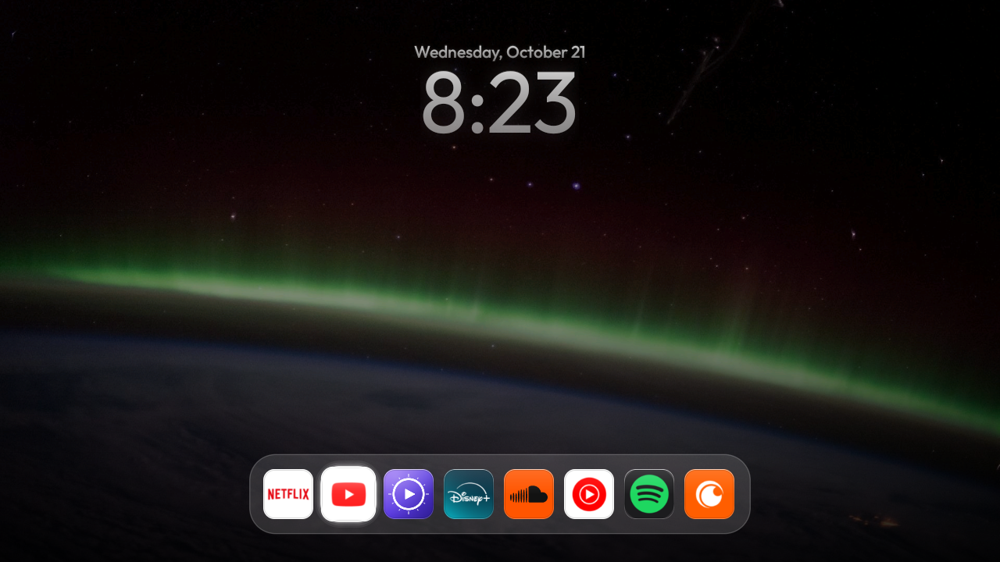
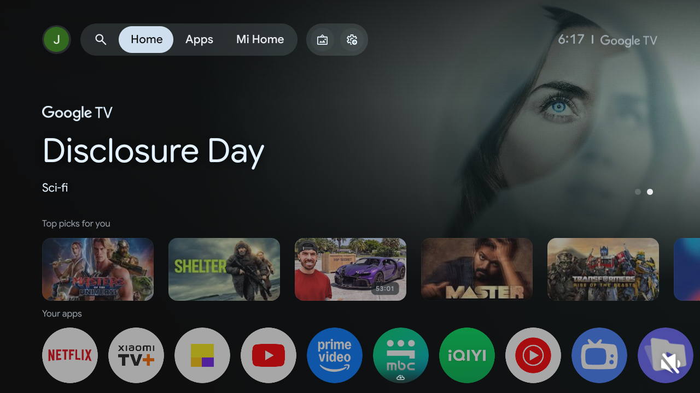
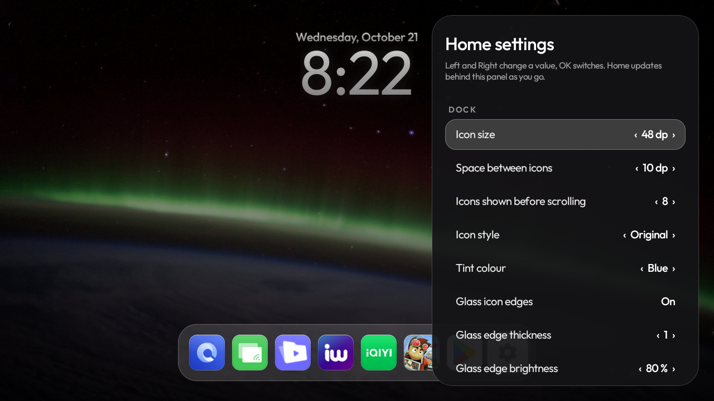
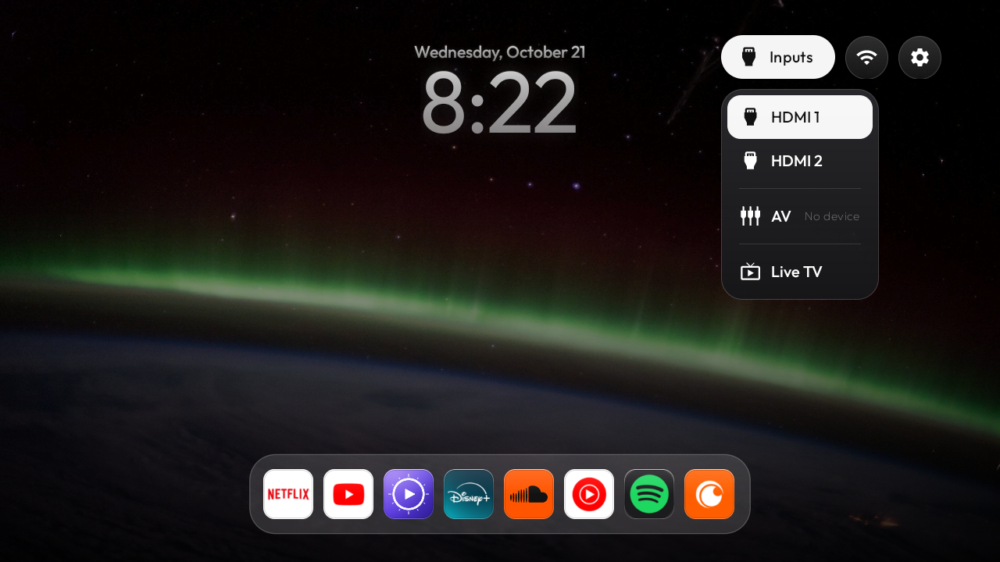
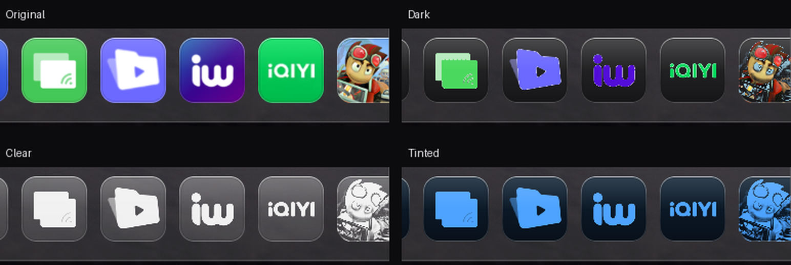

<h1 align="center">glassOS-tv</h1>

<p align="center">
  <b>A Liquid Glass home screen for Android TV.</b><br>
  Free, ad-free launcher with a macOS-style dock, a frosted lock-screen clock, iOS-style icon looks,
  photo wallpapers and settings you change from the sofa. Light enough for a 1 GB TV.
</p>

<p align="center">
  
</p>

| Before (stock Google TV) | After (glassOS-tv) |
|---|---|
|  |  |

## Features

- **Glass dock.** One row of square app icons in a translucent band, macOS style. Scrolls sideways when
  there are more apps than fit; Settings is always last. A single glass highlight follows your focus.
- **Lock-screen clock.** Big centred time and date in frosted, see-through type with a soft shadow, so it
  reads on dark and bright wallpapers alike.
- **Icon styles.** Original, **Dark**, **Clear** and **Tinted** (pick the tint colour), made on the TV
  from each app's own icon, plus optional glass edges on every icon.
- **Wallpapers.** Six built-in gradients, 14 photos (Earth from the Space Station, landscapes, cities),
  your own pictures, or **Change daily** for a new one each day. Changes crossfade smoothly.
- **Home settings on the TV.** Hold OK on the Settings icon: a floating panel opens over Home, and Home
  updates live behind it as you change icon size, spacing, dock height, clock size and thickness, date
  size and position, shadows, wallpaper, dimming, and app order and visibility.
- **Inputs and Wi-Fi.** Hold Up on the dock for Inputs (HDMI, AV, Live TV), Wi-Fi and Settings pills.
- **Lightweight.** About 300 KB, no blur, no video, no network polling. Built and tested on a 1 GB TV.

<p align="center">
  
  
</p>

<p align="center">
  
</p>

## Install

You need a computer on the same Wi-Fi as the TV, with Python 3, JDK 17 and the Android SDK
(`platforms;android-34`, `build-tools;34.0.0`). On macOS:

```bash
brew install openjdk@17 && brew install --cask android-commandlinetools
```

1. On the TV: **Settings → System → About**, press OK on **Build** 7 times, then turn on
   **Developer options → USB debugging** (and Network/Wireless debugging if your TV has it).
2. Set up the ADB client (no `adb` binary needed):

   ```bash
   python3 -m venv tools/venv && tools/venv/bin/pip install -r tools/requirements.txt
   ```

3. Build, install and make it the home screen (accept the "Allow USB debugging?" prompt on the TV):

   ```bash
   TV_HOST=192.168.1.50 launcher/build-and-install.sh
   ```

   On Google TV, the setup wizard also claims Home; see
   [docs/TROUBLESHOOTING.md](docs/TROUBLESHOOTING.md) before disabling it, because it can own your
   saved Wi-Fi network.

4. Optional, the photo wallpapers:

   ```bash
   TV_HOST=192.168.1.50 tools/push-wallpapers.sh
   ```

When you're done, turn USB debugging off again and revoke the authorisations: port 5555 is plaintext.

### Debloat (optional)

This project keeps CleanYourTV's debloat tooling: back up, disable telemetry and ad rows in small
batches, and restore with one script. See [docs/CLEANYOURTV.md](docs/CLEANYOURTV.md) and the per-model
lists in [examples/](examples), including
[examples/xiaomi-mitv-axfu0](examples/xiaomi-mitv-axfu0/debloat.txt). Nothing is uninstalled.

## Using it

| On the remote | Does |
|---|---|
| Left / Right on the dock | Move between apps (the dock scrolls) |
| OK | Open the app |
| Hold Up on the dock | Show the Inputs, Wi-Fi and Settings pills |
| OK on Settings (last icon) | TV settings |
| **Hold OK on Settings** | **Home settings** panel |
| Home | Back to the first app |

In Home settings: Left/Right change a value, OK switches it, and in the app list OK picks an app up,
Up/Down moves it, OK drops it, Right hides or shows it.

### Your own wallpapers

Drop a 1920×1080 JPEG into `wallpapers/` and push it. The file name becomes its name in the list
(`tahoe_day.jpg` shows as "Tahoe Day"):

```bash
TV_HOST=192.168.1.50 tools/push-wallpapers.sh wallpapers/tahoe_day.jpg
```

## Tested on

| TV | OS | Notes |
|---|---|---|
| Xiaomi MiTV-AXFU0 (arctictale, Amlogic, 1 GB) | Google TV 14 | Everything above; setup-wizard and Wi-Fi notes in the debloat list |

It should work on most Android TV and Google TV sets (Xiaomi, TCL, Hisense, Sony, Philips, Nvidia
Shield). Not on Samsung Tizen, LG webOS or Fire TV. Tried it on another TV? Open an issue or PR with your
model.

## Credits

- Built on [CleanYourTV](https://github.com/Gathin23/cleanyourtv) by Gathin (MIT): the debloat tools and
  the launcher this project grew from.
- Typeface: [Outfit](https://fonts.google.com/specimen/Outfit), SIL Open Font License
  ([launcher/FONT-LICENSE-OFL.txt](launcher/FONT-LICENSE-OFL.txt)).
- Wallpapers: NASA (public domain) and Wikimedia Commons photographers (Creative Commons). Names and
  licences in [wallpapers/CREDITS.md](wallpapers/CREDITS.md); keep that file with the pictures.
- Inspired by Apple's Liquid Glass design. glassOS-tv is an independent project, not affiliated with or
  endorsed by Apple or Google.

## License

MIT, see [LICENSE](LICENSE). The wallpaper photos keep their own licences.
